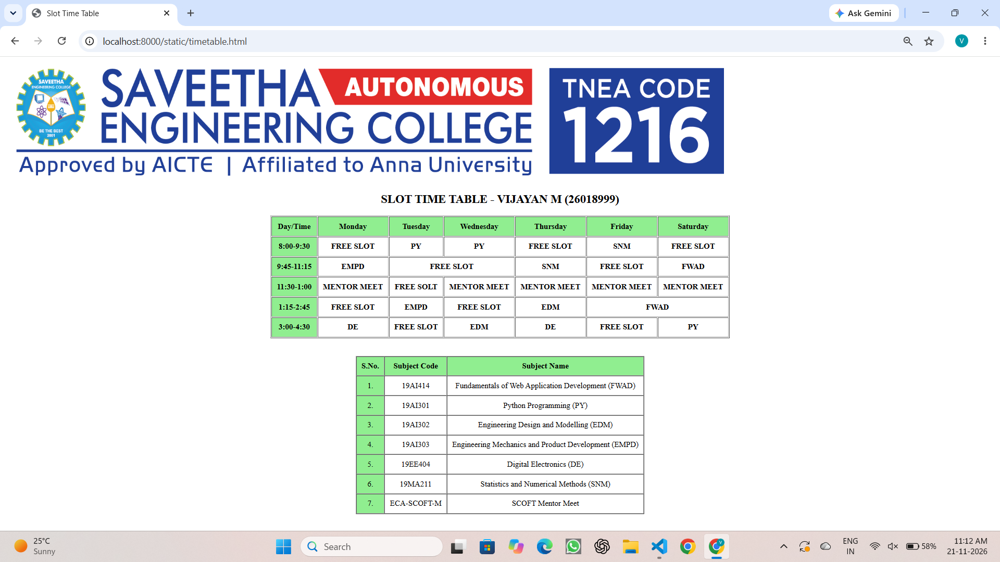

# Ex04 Time Table
## Date:21-11-2026

## AIM
To write a html webpage page to display your slot timetable.

## ALGORITHM
### STEP 1
Create a Django-admin Interface.

### STEP 2
Create an App inside the Django project.

### STEP 2
Create a static folder uder the created App and insert HTML code.

### STEP 3
Create a simple table using ```<table>``` tag in html with the relevant attributes.

### STEP 4
Add rows using ```<tr>``` tag.

### STEP 5
Add your course schedule using ```<td>``` tag.

### STEP 6
Execute the program using runserver command.

## PROGRAM
```
<html>
<head>
    <title>Slot Time Table</title>
</head>
<body >

    
    <h2 align="center">SLOT TIME TABLE - VIJAYAN M (26018999)</h2>

    <table border="1" cellpadding="10" cellspacing="2" align="center">
        <tr bgcolor="lightgreen" align="center">
            <th>Day/Time</th>
            <th>Monday</th>
            <th>Tuesday</th>
            <th>Wednesday</th>
            <th>Thursday</th>
            <th>Friday</th>
            <th>Saturday</th>
        </tr>
        <tr align="center">
            <td bgcolor="lightgreen"><b>8:00-9:30</b></td>
            <td><b>FREE SLOT</b></td>
            <td><b>PY</b></td>
            <td><b>PY</b></td>
            <td><b>FREE SLOT</b></td>
            <td><b>SNM</b></td>
            <td><b>FREE SLOT</b></td>
        </tr>
        <tr align="center">
            <td bgcolor="lightgreen"><b>9:45-11:15</b></td>
            <td><b>EMPD</b></td>
            <td colspan="2"><b>FREE SLOT</b></td>
            <td><b>SNM</b></td>
            <td><b>FREE SLOT</b></td>
            <td><b>FWAD</b></td>
        </tr>
        <tr align="center">
            <td bgcolor="lightgreen"><b>11:30-1:00</b></td>
            <td><b>MENTOR MEET</b></td>
            <td><b>FREE SOLT</b></td>
            <td><b>MENTOR MEET</b></td>
            <td><b>MENTOR MEET</b></td>
            <td><b>MENTOR MEET</b></td>
            <td><b>MENTOR MEET</b></td>
        </tr>
        <tr align="center">
            <td bgcolor="lightgreen"><b>1:15-2:45</b></td>
            <td><b>FREE SLOT</b></td>
            <td><b>EMPD</b></td>
            <td><b>FREE SLOT</b></td>
            <td><b>EDM</b></td>
            <td colspan="2"><b>FWAD</b></td>
        </tr>
        <tr align="center">
            <td bgcolor="lightgreen"><b>3:00-4:30</b></td>
            <td><b>DE</b></td>
            <td><b>FREE SLOT</b></td>
            <td><b>EDM</b></td>
            <td><b>DE</b></td>
            <td><b>FREE SLOT</b></td>
            <td><b>PY</b></td>
        </tr>
    </table>

    <br><br>

    <table border="1" cellpadding="10" cellspacing="1" align="center">
        <tr bgcolor="lightgreen" align="center">
            <th>S.No.</th>
            <th>Subject Code</th>
            <th>Subject Name</th>
        </tr>
        <tr align="center">
            <td bgcolor="lightgreen">1.</td>
            <td>19AI414</td>
            <td>Fundamentals of Web Application Development (FWAD)</td>
        </tr>
        <tr align="center">
            <td bgcolor="lightgreen">2.</td>
            <td>19AI301</td>
            <td >Python Programming (PY)</td>
        </tr>
        <tr align="center">
            <td bgcolor="lightgreen">3.</td>
            <td>19AI302</td>
            <td >Engineering Design and Modelling (EDM)</td>
        </tr>
        <tr align="center">
            <td bgcolor="lightgreen">4.</td>
            <td>19AI303</td>
            <td >Engineering Mechanics and Product Development (EMPD)</td>
        </tr>
        <tr align="center">
            <td bgcolor="lightgreen">5.</td>
            <td>19EE404</td>
            <td >Digital Electronics (DE)</td>
        </tr>
        <tr align="center">
            <td bgcolor="lightgreen">6.</td>
            <td>19MA211</td>
            <td >Statistics and Numerical Methods (SNM)</td>
        </tr>
        <tr align="center">
            <td bgcolor="lightgreen">7.</td>
            <td>ECA-SCOFT-M</td>
            <td >SCOFT Mentor Meet</td>
        </tr>
    </table>

</body>
</html>
```

## OUTPUT


## RESULT
The program for creating slot timetable using basic HTML tags is executed successfully.
